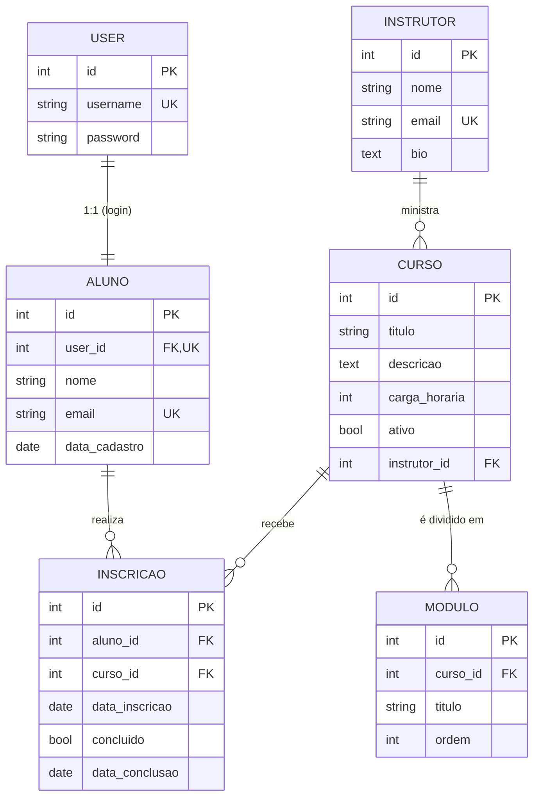

# Modelo Entidade-Relacionamento

## Relacionamentos

| Relação | Tipo | Implementação |
|---|---|---|
| Usuário ↔ Aluno | 1:1 | `Aluno.user` (`OneToOneField`) |
| Instrutor → Cursos | 1:N | `Curso.instrutor` (`ForeignKey`, `PROTECT`) |
| Curso → Módulos | 1:N | `Modulo.curso` (`ForeignKey`, `CASCADE`) |
| Aluno ↔ Curso | N:N | Tabela associativa `Inscricao` (`ManyToManyField(through=...)`) |

## Dicionário de dados

**Instrutor**: `nome` (texto, obrigatório), `email` (único), `bio` (opcional).

**Aluno**: `user` (login 1:1), `nome`, `email` (único), `data_cadastro` (automática).

**Curso**: `titulo`, `descricao`, `carga_horaria` (horas, inteiro positivo), `ativo` (padrão `true`), `instrutor` (obrigatório).

**Modulo**: `curso`, `titulo`, `ordem` (inteiro positivo).

**Inscricao**: `aluno`, `curso`, `data_inscricao` (automática), `concluido` (padrão `false`), `data_conclusao` (preenchida automaticamente ao concluir).

## Regras de integridade

- `Inscricao`: par (`aluno`, `curso`) **único**: ninguém se inscreve duas vezes no mesmo curso.
- `Modulo`: par (`curso`, `ordem`) **único**: não há dois módulos na mesma posição do curso.
- Não é possível **remover um instrutor** que ainda tenha cursos (`PROTECT`; a API responde 409).
- Remover um curso remove seus módulos e inscrições (`CASCADE`).
- Não é possível **criar inscrição** em curso inativo (validação na API).
